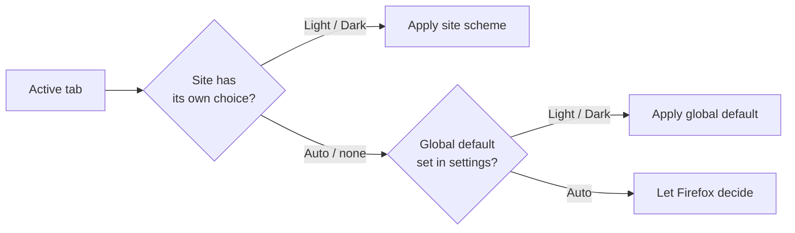

<div align="center">


# Tab Color Scheme

**Light or dark, chosen per site and remembered.**

A Firefox extension that sets the color scheme websites see, based on the site in the active tab.

[](https://addons.mozilla.org/en-US/firefox/addon/tab-color-scheme/)
[](https://addons.mozilla.org/en-US/firefox/addon/tab-color-scheme/)
[](https://addons.mozilla.org/en-US/firefox/addon/tab-color-scheme/)
[](https://github.com/vrtexe/tab-color-scheme/actions/workflows/publish-package.yml)
[](LICENSE.md)

[**Install from addons.mozilla.org →**](https://addons.mozilla.org/en-US/firefox/addon/tab-color-scheme/)

</div>

---

## Why

Some sites look better dark, some only work well light, and Firefox offers a single "Website appearance" setting for all of them. Tab Color Scheme lets you pick a scheme for each site once. When you switch to a tab, the extension applies that site's scheme, and sites that follow `prefers-color-scheme` render accordingly.

## Features

- 🎯 **Per-site choice.** Pick Auto, Light or Dark for the site in the active tab from the toolbar popup. The choice is stored per host.
- 🌐 **Global default.** The settings page sets the scheme for every site that has no choice of its own.
- 🔄 **Follows your tabs.** The scheme updates when you switch tabs, navigate to another site or focus another window.
- 🖼️ **Toolbar feedback.** The toolbar icon and tooltip show the scheme in effect.
- 🔒 **Local only.** Nothing leaves your browser. See [Privacy](#privacy).

|  |  |  |
| :---: | :---: | :---: |
| **Auto** | **Light** | **Dark** |
| Use the default from settings | Force light color scheme | Force dark color scheme |

## How the scheme is chosen



Auto in the popup means "use the default from settings". Pages that are not `http` or `https` (for example `about:` pages) have no per-site choice and use the global default.

## Setup

The toolbar icon follows the browser theme only when Firefox lets extension SVGs use context colors:

1. Open `about:config` in Firefox.
2. Search for `svg.context-properties.content.enabled`.
3. Set it to `true`.

Without this setting the extension works, but the icon may not match your theme.

## Privacy

The extension remembers a color scheme per site in local extension storage and never sends it anywhere.

Firefox lets an extension set only one color scheme for all web content, so the scheme of the site in the active tab applies to every open page. A page you have open can therefore see the scheme change when you switch tabs or windows. A page that opens other sites in a window it controls can also use this to find out which sites have a scheme stored.

## Development

Requires Node.js and Firefox.

```sh
npm install
npm run dev        # start Firefox with the extension loaded (web-ext run)
npm test           # unit tests
npm run test:e2e   # browser tests with Selenium and Firefox
npm run package    # build the .zip into web-ext-artifacts/
```

The end-to-end tests look for Firefox at the default macOS location. Set `FIREFOX_BIN` to use another binary.

### Project layout

| Path | Purpose |
| --- | --- |
| `src/main.js` | Background script; the only place that sets the browser's color scheme |
| `src/popup/` | Toolbar popup for the per-site choice |
| `src/settings/` | Settings page for the global default |
| `src/shared.js` | Storage helpers and host extraction shared by all parts |
| `test/` | Unit tests (`*.test.js`) and end-to-end tests (`e2e/`) |

### Releasing

Creating a GitHub release runs the [publish workflow](.github/workflows/publish-package.yml), which signs the extension and submits it to addons.mozilla.org.

## License

[MIT](LICENSE.md)
